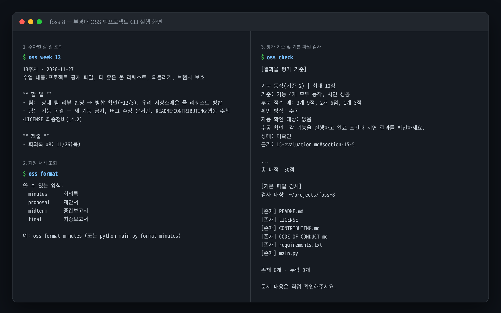

[한국어](README.md) | **English**

# foss-8

A CLI tool that supports team project work in the Open Source Software course at Pukyong National University.

It brings the templates, evaluation criteria, weekly schedule, and GitHub activity logs scattered throughout the project guide into the terminal, and helps generate meeting drafts and submission-ready PDFs.



## Key Features

> Implemented around three core features for an approved 3-member team. See [team-specific adaptations](docs/guide/team-context.md) for details.

| Feature | Commands | Description | Owner |
|---|---|---|---|
| Weekly schedule & progress | `oss week`, `oss week --list` | View class topics, tasks, and deadlines for the current, specific, or makeup week from the 15-week roadmap, with task completion (`--done`) and weekly notes (`--memo`) | 양하윤 |
| Templates, drafts & PDF export | `oss format`, `oss activity` | Generate Markdown templates for minutes, proposal, interim, and final reports; prefill team info, previous actions, and GitHub activity; export submission PDFs | 박상재 |
| Evaluation, file & activity checks | `oss check`, `oss check activity` | Show the 4 deliverable evaluation criteria (30 pts), check the 6 required repository files and the `v1.0.0` tag on `origin`, and inspect weekly GitHub activity per member | 백지훈 |

## Team Project Guide

See the [full table of contents](docs/guide/README.md) for schedules, deliverables, evaluation criteria, collaboration rules, templates, and FAQs. The full guide and [team-specific adaptations](docs/guide/team-context.md) are both available.

## Installation & Setup

- **Requirements**: Python 3.12 or later (tested on Python 3.12 and 3.14)
- **Third-party Python packages**: None (standard library only)
- **Optional tools**: Chrome or Chromium with Korean fonts for PDF export; GitHub CLI (`gh`) for GitHub activity lookup

Once installed, the tool can also run from other teams' project directories. The weekly schedule and evaluation criteria follow this course's project guide.

### Install with `pipx`

Follow the [pipx installation instructions](https://pipx.pypa.io/stable/how-to/install-pipx.html) to install pipx, then run `pipx ensurepath`.
Restart your terminal if needed, then install the tool with the following command. Git is also required.

```bash
pipx install git+https://github.com/sangjaepark0000/foss-8.git
```

After installation, navigate to your team's project directory and run:

```bash
cd 팀-프로젝트
oss --help
oss week --list
oss check                 # Check the basic files in the current directory
oss format minutes        # Display the meeting minutes template
```

With `oss` installed, replace `python main.py` with `oss` in the examples below.
Run `pipx upgrade foss8` to update the tool, or `pipx uninstall foss8` to uninstall it.

### Development Setup (`git clone`)

Clone the repository to run the tool directly, or install it in editable mode in a virtual environment.

```bash
git clone https://github.com/sangjaepark0000/foss-8.git
cd foss-8
python3 -m venv .venv
source .venv/bin/activate  # Windows: .venv\Scripts\activate
pip install -r requirements.txt
python main.py --help
```

To use the `oss` command inside the virtual environment, install the package in editable mode:

```bash
python -m pip install -e .
oss --help
```

## Usage

### 1. Checking the Weekly Schedule (`week`)

```bash
python main.py week                      # Upcoming nearest week's tasks
python main.py week --list               # List all weeks in the roadmap
python main.py week 13                   # View a specific week (Week 13)
python main.py week makeup               # View the makeup week (Dec 11; "week 보강" is also supported)
python main.py week 2 --done 1           # Toggle completion for task #1
python main.py week 2 --memo 회의 전 확인  # Save or replace the note for Week 2
python main.py week 2 --memo             # Delete the note for Week 2
python main.py week --help
```

Example output (`python main.py week 13`):

```text
13주차 · 2026-11-27
수업 내용:프로젝트 공개 파일, 더 좋은 풀 리퀘스트, 되돌리기, 브랜치 보호

** 할 일 **
1. [--] 팀: 상대 팀 리뷰 반영 → 병합 확인(~12/3). 우리 저장소에온 풀 리퀘스트 병합
2. [--] 팀: 기능 동결 — 새 기능 금지, 버그 수정·문서만. README·CONTRIBUTING·행동 수칙·LICENSE 최종정비(14.2)

** 제출 **
• 회의록 #8: 11/26(목)
```

Omitting the week selects the nearest upcoming class date, or the final week once all class dates have passed.
`--done` takes the printed task number and toggles completion when run again with the same number.
One note is stored per week, and passing new text replaces the existing note. Completion states and notes persist across runs.

Progress is stored under the current user account in `foss8/week_progress.json`:
under `$XDG_DATA_HOME` (default `~/.local/share`) on Linux, `~/Library/Application Support` on macOS,
and `%APPDATA%` (default `AppData/Roaming` in the user directory) on Windows.
Separate clones run under the same user account share this file.

When the guide changes, the latest task list is displayed: completion states for tasks with matching role and text and weekly notes are preserved, while newly added or modified tasks start incomplete.

### 2. Displaying Templates (`format`)

Requires Python 3.12 or later. Displaying templates requires no third-party libraries.

```bash
python main.py format             # List available templates
python main.py format minutes     # Blank meeting minutes template
python main.py format proposal    # Project proposal template
python main.py format midterm     # Interim report template
python main.py format final       # Final report template
python main.py format --help
```

The meeting minutes template preserves the headings and table columns from Appendix B of the guide, with example names, dates, progress entries, and completion marks left blank.
The report templates use the guide's seven proposal sections, six interim report sections, eight final report sections, and appendices
to provide cover pages, tables of contents, fields to fill in, required content, length requirements, submission criteria, and links to the source material.

Fill in the generated Markdown, then convert it to PDF for submission.
Blank templates remain available. You can also use the commands below to save meeting minutes with basic information filled in.

### 3. Generating a Meeting Minutes Draft

```bash
python main.py format minutes --date 2026-10-28 -o docs/meetings/2026-10-28.md
python main.py format minutes --date 2026-10-28 --week 9 --team foss-8 -o 회의록.md
```

The command selects the nearest submission after the meeting date and fills in the WEEK number, the record period, and the submission deadline.
The October 28 meeting is WEEK9, with a record period of 10/15–10/28 and a submission deadline of 10/29 18:00.
Academic weeks run from Tuesday to Monday, and the meeting date, the submission round, and the record period are kept separate. Week 8 has no submission round,
and the October 29 submission after the exams is required. Use `--week makeup` to select the December 11 makeup submission.

Team details are read from `.foss8/team.json` in the current project when that file exists, and otherwise from the Git remote and the team member table in the README.
To specify a file directly, use `--team-file 팀정보.json`. The command does not create or change the configuration on its own.

```json
{
  "name": "우리팀",
  "project": "프로젝트 이름",
  "repository": "https://github.com/owner/repository",
  "members": [
    {"name": "가람", "github": "garam"},
    {"name": "나래", "github": "narae"}
  ]
}
```

It adds a blank row for each member and that week's tasks and checklist from the guide. Actual attendance, the note-taker, progress, decisions, activity counts, and completion checks are left blank.
Omitting `-o` prints the result to the screen. Existing files are protected and replaced only when `--force` is also given.
Saving a report the same way, as in `python main.py format midterm -o 중간보고서.md`, fills the cover page with the same team information. `--team-file` selects the configuration used for the report.
Tasks from a previous minutes file can be copied into the check draft with `--previous docs/meetings/2026-10-07.md`. The original file is not modified, and the status is for you to confirm. After you log in with `gh`, GitHub activity can be collected and the generated JSON attached to the minutes.

```bash
python main.py activity --repo owner/repo --start 2026-10-08 --end 2026-10-14 -o 활동.json
python main.py format minutes --date 2026-10-14 --activity 활동.json -o 회의록.md
```

Pass `--force` to `activity` when overwriting an existing activity JSON file.

After logging in with `gh`, pass `--fetch-activity` to query GitHub activity for the minutes' recording period and prefill each member's activity log row. Evidence links and any lookup failures appear at the end of the document.

```bash
python main.py format minutes --date 2026-10-14 --fetch-activity
```

The command prints the draft to stdout; add `-o 회의록.md` to save it to a file. `--fetch-activity` and `--activity` are mutually exclusive.

The period includes each date in Korea Standard Time. Commits are taken from every reachable branch, excluding duplicate SHAs and merge commits. Pull request creation and merges are attributed to the PR author, and reviews to the person who submitted them. Ordinary comments are excluded. A failed lookup is distinguished from zero results, and the links and results should be checked directly.
Specifying `--activity 활동.json` on an interim or final report adds a draft of supporting material that includes release and minutes links and candidate representative pull requests. Activity JSON from other repositories can be created and passed with `--activity` more than once. Existing files are not overwritten.

### 4. Converting Completed Meeting Minutes to Submission PDF

```bash
python main.py format minutes --pdf docs/meetings/2026-10-28.md
python main.py format minutes --pdf 회의록.md -o 제출/회의록.pdf
```

Edit the Markdown file to fill in the actual meeting notes, then convert it. By default, the PDF is saved in the same folder as the source file,
named `[WEEK9] 회의록_팀명.pdf` using the submission round and team name from the document title.
Existing files formatted as `# [WEEK7] 회의록 — foss-8` can also be converted. `[WEEK4]` corresponds to the December 11 makeup submission.
For untitled documents, specify `--week 9 --team 팀명` together. If the document title conflicts with the specified round or team name, the tool prompts for confirmation.

Supports Korean text, tables, checklists, links, and multi-page output. **Chrome or Chromium and Korean fonts** are required,
with no additional Python libraries needed. If a browser cannot be detected automatically, install one or specify its path with `--browser /path/to/executable`.
If Korean characters fail to render, install a Korean font such as Noto Sans CJK KR.

The original Markdown file is left unmodified. Existing PDFs are protected and replaced only when `--force` is given.
If conversion fails, any existing submission file is preserved, and generating a PDF alone does not mark the LMS submission as complete.

### 5. Checking Evaluation Criteria and Basic Files (`check`)

```bash
python main.py check                    # Check the current directory
python main.py check --path "path/to/directory"
python main.py check --help             # View options
```

`check` prints the four deliverable evaluation criteria from the guide along with their point values, verification methods, and manual review notes.
Each criterion's status is displayed as `미확인` (unverified), as completion is not determined automatically.

The basic file check verifies whether `README.md`, `LICENSE`, `CONTRIBUTING.md`,
`CODE_OF_CONDUCT.md`, `requirements.txt`, and `main.py` exist in the target directory, and summarizes status counts (`존재 N개 · 누락 M개`) at the end.
Omitting `--path` inspects the current working directory.

Next, `[태그 검사]` checks whether the `v1.0.0` tag exists on the repository's `origin` remote (`[존재]` / `[없음]` / `[확인 불가]`).

Even when all files exist, their contents, functional behavior, reproducibility, and collaboration workflows must still be verified manually.
Specifying a directory or file path that does not exist produces an error.

### 6. Checking GitHub Activity (`check activity`)

Run inside a project directory after installing the GitHub CLI (`gh`) and signing in with `gh auth login`.

```bash
python main.py check activity                 # Check each member's activity for this week
python main.py check activity --rules         # Show weekly minimum criteria
python main.py check activity --last-7-days   # Check the last 7 days including today
python main.py check activity --show-links    # Show evidence links included in the summary
python main.py check activity --path "dir"    # Check activity for another project folder
```

`check activity` summarizes commits, pull requests created/merged, and issues opened from Monday of the current week through today (KST).
A cell such as `1/2` means 1 completed out of a weekly minimum of 2.
`--rules` shows the minimum criteria and active dates without connecting to GitHub.
`--last-7-days` queries the trailing 7 days including today.
To save activity for a fixed date range such as a past minutes period, use `activity --start YYYY-MM-DD --end YYYY-MM-DD`.

Substantive quality, pre-work issue registration, and pre-merge PR approval must still be verified manually.

### Verification

```bash
python -m unittest discover -s tests -v
python scripts/check_guide.py
```

## Team & Contributing

| Name | Role | GitHub | Responsibilities |
|---|---|---|---|
| 박상재 | Team lead | @sangjaepark0000 | Template retrieval |
| 양하윤 | Development lead | @sheep-ship-it | Current week and task lookup |
| 백지훈 | Documentation | @jihun31 | Evaluation criteria and completion checks |

Please read the [Contributing Guide (CONTRIBUTING.md)](CONTRIBUTING.md) for workflow rules and the [Code of Conduct (CODE_OF_CONDUCT.md)](CODE_OF_CONDUCT.md) for community expectations.

## License

MIT License — see [LICENSE](LICENSE)
