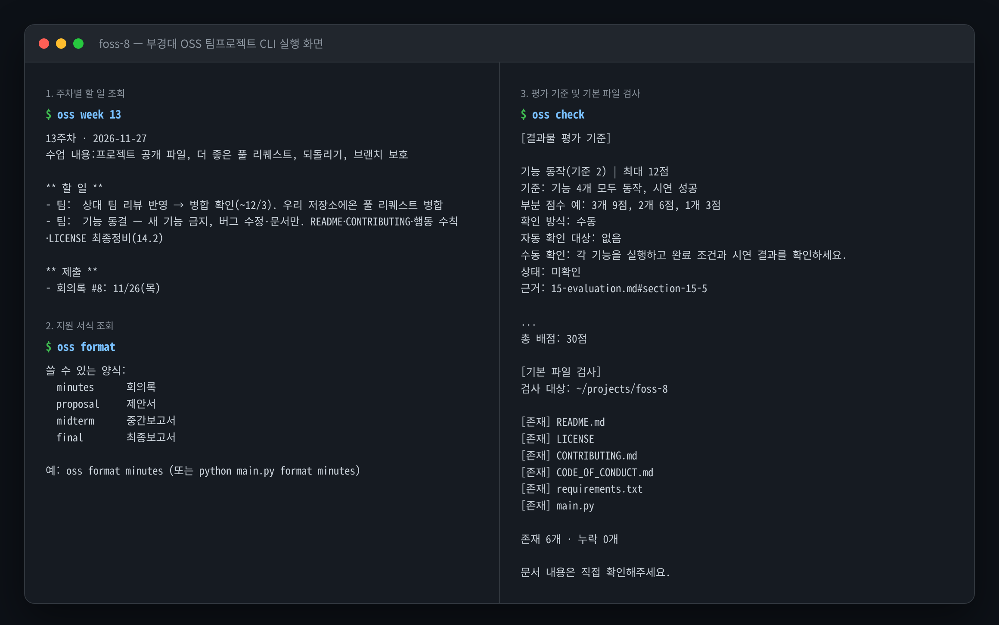

**한국어** | [English](README.en.md)

# foss-8

부경대학교 오픈소스소프트웨어 수업의 팀 프로젝트 진행을 돕는 CLI 도구입니다.

프로젝트 안내서에 흩어져 있는 서식, 평가 기준, 주차별 일정, GitHub 활동 기록을 터미널에서 쉽게 확인하고 문서 초안과 제출용 PDF까지 만들 수 있도록 돕습니다.



## 주요 기능

> 승인된 3인 팀 구성에 따라 핵심 기능 3개를 중심으로 구현했습니다. 자세한 팀 적용 기준은 [팀 적용 사항](docs/guide/team-context.md)을 참고하세요.

| 기능 | 주요 명령 | 설명 | 담당 |
|---|---|---|---|
| 주차별 일정 확인 | `oss week`, `oss week --list` | 안내서 15주 로드맵 기준 현재/특정/보강 주차의 수업 내용·할 일·제출 마감 조회 | 양하윤 |
| 서식 조회·초안·PDF 변환 | `oss format`, `oss activity` | 회의록·제안서·중간·최종보고서 Markdown 양식 생성, 팀 정보·이전 할 일·GitHub 활동 로그 채움, 제출용 PDF 변환 | 박상재 |
| 평가 기준·기본 파일·활동 점검 | `oss check`, `oss check activity` | 결과물 평가 기준 4개(30점) 안내, 필수 공개 파일 6종 검사, 주간 최소 활동 기준 대비 팀원별 GitHub 실적 점검 | 백지훈 |

## 팀프로젝트 안내서

[안내서 전체 목차](docs/guide/README.md)에서 일정·제출물·평가 기준·협업 규칙·양식·FAQ를 확인할 수 있습니다. 원문 전체와 [팀 적용 사항](docs/guide/team-context.md)을 함께 제공합니다.

## 설치 및 실행 방법

- **지원 환경**: Python 3.12 이상 (Python 3.12 / 3.14에서 테스트 완료)
- **외부 Python 라이브러리**: 없음 (표준 라이브러리만 사용)
- **선택 도구**: PDF 변환 시 Chrome 또는 Chromium과 한글 글꼴, GitHub 활동 조회 시 GitHub CLI(`gh`)

프로그램을 설치한 뒤에는 다른 팀의 프로젝트 폴더에서도 실행할 수 있습니다. 주차와 평가 기준은 이 수업의 안내서를 따릅니다.

### 설치해서 사용하기 (`pipx`)

[pipx 설치 안내](https://pipx.pypa.io/stable/how-to/install-pipx.html)에 따라 pipx를 설치하고 `pipx ensurepath`를 실행합니다.
필요하면 터미널을 다시 연 뒤 다음 명령으로 도구를 설치합니다. Git도 필요합니다.

```bash
pipx install git+https://github.com/sangjaepark0000/foss-8.git
```

설치 후 사용하려는 팀 프로젝트로 이동해 실행합니다.

```bash
cd 팀-프로젝트
oss --help
oss week --list
oss check                 # 현재 폴더의 기본 파일 검사
oss format minutes        # 회의록 서식 조회
```

설치된 `oss` 명령에서는 아래 예시의 `python main.py`를 `oss`로 바꿔 사용하면 됩니다.
`pipx upgrade foss8`으로 업데이트하고, `pipx uninstall foss8`으로 제거할 수 있습니다.

### 개발용 실행 (`git clone`)

저장소를 클론해 직접 실행하거나 가상환경에 편집 가능 모드로 설치할 수 있습니다.

```bash
git clone https://github.com/sangjaepark0000/foss-8.git
cd foss-8
python3 -m venv .venv
source .venv/bin/activate  # Windows: .venv\Scripts\activate
pip install -r requirements.txt
python main.py --help
```

`oss` 명령으로 실행하려면 가상환경에서 아래 명령으로 설치합니다.

```bash
python -m pip install -e .
oss --help
```

## 사용법

### 1. 주차별 일정 확인 (`week`)

```bash
python main.py week           # 다가오는 가장 가까운 주차 할 일
python main.py week --list    # 전체 주차 목록 확인
python main.py week 13        # 특정 주차(13주차) 조회
python main.py week makeup    # 4주차 보강(12/11) 일정 조회 (week 보강도 가능)
```

예시 출력(`python main.py week 13`):

```text
13주차 · 2026-11-27
수업 내용:프로젝트 공개 파일, 더 좋은 풀 리퀘스트, 되돌리기, 브랜치 보호

** 할 일 **
- 팀: 상대 팀 리뷰 반영 → 병합 확인(~12/3). 우리 저장소에 온 풀 리퀘스트 병합
- 팀: 기능 동결 — 새 기능 금지, 버그 수정·문서만. README·CONTRIBUTING·행동 수칙·LICENSE 최종 정비(14.2)

** 제출 **
- 회의록 #8: 11/26(목)
```

### 2. 서식 조회 (`format`)

Python 3.12 이상에서 실행합니다. 서식 조회에는 외부 라이브러리가 필요하지 않습니다.

```bash
python main.py format             # 지원 양식 목록
python main.py format minutes     # 빈 회의록
python main.py format proposal    # 제안서
python main.py format midterm     # 중간보고서
python main.py format final       # 최종보고서
python main.py format --help
```

회의록은 안내서 부록 B의 제목·표 열을 유지하고 예시 이름·날짜·진행 상황·완료 표시를 비운 양식입니다.
보고서는 안내서의 제안서 7항목·중간보고서 6항목·최종보고서 8항목과 부록을 읽어
표지·목차·작성란·필수 내용·분량·제출 기준·원문 링크를 제공합니다.

출력된 Markdown에 내용을 작성한 후 PDF로 변환해 제출합니다.
빈 서식 출력은 유지하며, 아래 명령으로 기본정보를 채운 회의록을 파일로 저장할 수 있습니다.

### 3. 회의록 초안 생성

```bash
python main.py format minutes --date 2026-10-28 -o docs/meetings/2026-10-28.md
python main.py format minutes --date 2026-10-28 --week 9 --team foss-8 -o 회의록.md
```

회의 날짜 이후 가장 가까운 제출분을 골라 WEEK 번호·기록기간·제출 마감을 채웁니다.
10/28 회의는 WEEK9, 기록기간 10/15~10/28, 제출 마감 10/29 18:00입니다.
학사 주차는 화~월이며 회의 날짜·제출 회차·기록기간을 구분합니다. 8주차는 제출 회차가 없고,
시험 이후 10/29 제출분은 필요합니다. 12/11 보강 제출분을 지정하려면 `--week makeup`을 사용합니다.

팀 기본정보는 현재 프로젝트의 `.foss8/team.json`이 있으면 읽고, 없으면 Git 원격 저장소와 README 팀원 표에서 읽습니다.
파일을 직접 지정하려면 `--team-file 팀정보.json`을 사용합니다. 설정을 자동 생성하거나 변경하지 않습니다.

```json
{
  "name": "우리팀",
  "project": "프로젝트 이름",
  "repository": "https://github.com/owner/repository",
  "members": [
    {"name": "가람", "github": "garam"},
    {"name": "나래", "github": "narae"}
  ]
}
```

팀원별 빈 행과 안내서의 해당 주차 할 일·점검표를 넣습니다. 실제 참석·서기·진행 상황·결정·활동 횟수·완료 체크는 비워 둡니다.
`-o`를 생략하면 화면에 출력합니다. 기존 파일은 보호하고 `--force`를 함께 지정했을 때만 교체합니다.
보고서도 `python main.py format midterm -o 중간보고서.md`처럼 저장하면 같은 팀 정보로 표지를 채웁니다. `--team-file`로 보고서에 사용할 설정을 직접 선택할 수 있습니다.
이전 회의록의 할 일은 `--previous docs/meetings/2026-10-07.md`로 점검 초안에 복사할 수 있습니다. 원본은 수정하지 않으며 상태는 직접 확인합니다. GitHub 활동은 `gh` 로그인 후 수집하고, 생성한 JSON을 회의록에 첨부할 수 있습니다.

```bash
python main.py activity --repo owner/repo --start 2026-10-08 --end 2026-10-14 -o 활동.json
python main.py format minutes --date 2026-10-14 --activity 활동.json -o 회의록.md
```

기존 활동 JSON 파일을 덮어쓰려면 `activity` 명령에 `--force`를 함께 지정합니다.

`gh`에 로그인한 뒤 `--fetch-activity`를 지정하면 회의록의 기록기간으로 GitHub 활동을 조회해 팀원별 활동 로그 표를 채웁니다. 문서 끝에서 근거 링크와 조회 실패 이유를 확인할 수 있습니다.

```bash
python main.py format minutes --date 2026-10-14 --fetch-activity
```

위 명령은 초안을 화면에 출력합니다. 파일로 저장하려면 `-o 회의록.md`를 추가합니다. `--fetch-activity`와 `--activity`는 한 번에 하나만 지정할 수 있습니다.

기간은 한국 시간 날짜를 포함합니다. 커밋은 접근 가능한 브랜치 전체에서 SHA 중복과 병합 커밋을 제외하며, PR 생성·병합은 PR 작성자, 리뷰는 제출자를 기준으로 합니다. 일반 댓글은 제외합니다. 조회 실패와 0건을 구분하며 링크와 결과는 직접 확인해야 합니다.
중간·최종 보고서에도 `--activity 활동.json`을 지정하면 릴리스·회의록 링크와 대표 PR 후보를 포함한 근거 초안이 추가됩니다. 다른 저장소의 활동 JSON도 만들어 `--activity`를 여러 번 지정할 수 있습니다. 기존 파일은 덮어쓰지 않습니다.

### 4. 완성한 회의록을 제출용 PDF로 변환

```bash
python main.py format minutes --pdf docs/meetings/2026-10-28.md
python main.py format minutes --pdf 회의록.md -o 제출/회의록.pdf
```

Markdown을 편집해 실제 회의 내용을 작성한 다음 변환합니다. 기본 저장 위치는 원본과 같은 폴더이며,
문서 제목의 제출 회차·팀명을 사용해 `[WEEK9] 회의록_팀명.pdf`로 저장합니다.
기존에 작성한 `# [WEEK7] 회의록 — foss-8` 형식도 변환할 수 있습니다. `[WEEK4]`는 12/11 보강 제출분입니다.
제목이 없는 문서는 `--week 9 --team 팀명`을 함께 지정합니다. 제목과 명시한 회차·팀명이 다르면 확인을 요청합니다.

한글·표·체크리스트·링크와 여러 페이지 출력을 지원합니다. **Chrome 또는 Chromium과 한글 글꼴**이 필요하며,
추가 Python 라이브러리는 필요하지 않습니다. 브라우저를 찾지 못하면 설치하거나 `--browser /실행파일/경로`로 지정합니다.
한글이 보이지 않으면 Noto Sans CJK KR 등 한글 글꼴을 설치합니다.

원본 Markdown은 변경하지 않습니다. 기존 PDF는 보호하며 `--force`를 지정했을 때만 교체합니다.
변환 실패 시 기존 제출본을 보존하고, PDF 생성만으로 LMS 제출을 완료 처리하지 않습니다.

### 5. 평가 기준과 기본 파일 확인 (`check`)

```bash
python main.py check                    # 현재 폴더 검사
python main.py check --path "검사할 폴더 경로"
python main.py check --help             # 옵션 확인
```

`check`는 안내서의 결과물 평가 항목 4개와 배점, 확인 방식, 수동 확인 안내를 출력합니다.
평가 항목의 상태는 `미확인`으로 표시되며, 완료 여부를 자동으로 판정하지 않습니다.

기본 파일 검사는 지정한 폴더의 `README.md`, `LICENSE`, `CONTRIBUTING.md`,
`CODE_OF_CONDUCT.md`, `requirements.txt`, `main.py`의 존재 여부를 확인하고 결과 끝에 상태별 개수(`존재 N개 · 누락 M개`)를 요약합니다.
`--path`를 생략하면 명령을 실행한 현재 폴더를 검사합니다.

파일이 존재하더라도 문서 내용, 기능 동작, 실행 재현 및 협업 절차는 직접 확인해야 합니다.
존재하지 않는 폴더나 파일 경로를 지정하면 오류가 출력됩니다.

### 6. GitHub 활동 확인 (`check activity`)

프로젝트 폴더에서 실행합니다. 활동을 조회하려면 GitHub CLI(`gh`)를 설치하고 `gh auth login`으로 로그인합니다.

```bash
python main.py check activity                 # 이번 주 팀원별 활동 확인
python main.py check activity --rules         # 주간 최소 기준 확인
python main.py check activity --last-7-days   # 오늘을 포함한 최근 7일 활동 확인
python main.py check activity --show-links    # 집계에 포함된 활동 링크 확인
python main.py check activity --path "경로"   # 다른 프로젝트 폴더의 활동 확인
```

`check activity`는 이번 주 월요일부터 오늘까지의 활동을 조회합니다.
팀원별 커밋, PR 생성·병합, 이슈 작성 건수를 표로 표시합니다. `1/2`는 최소 기준 2건 중 1건을 했다는 뜻입니다.
`--rules`는 GitHub에 접속하지 않고 기준과 적용 기간을 보여줍니다.
`--last-7-days`는 오늘을 포함해 지난 7일을 조회합니다.
지난 회의록처럼 시작일과 종료일이 정해진 기간의 활동을 저장하려면 `activity --start YYYY-MM-DD --end YYYY-MM-DD`를 사용합니다.

커밋과 이슈가 실질적인 활동인지, 이슈를 작업 전에 등록했는지, PR이 병합 전에 승인됐는지는 직접 확인합니다.

### 검증

```bash
python -m unittest discover -s tests -v
python scripts/check_guide.py
```

## 팀원 및 기여

| 이름 | 역할 | GitHub | 담당 기능 |
|---|---|---|---|
| 박상재 | 팀장 | @sangjaepark0000 | 서식 불러오기 |
| 양하윤 | 개발 리드 | @sheep-ship-it | 현재 주차와 해야 할 일 확인 |
| 백지훈 | 문서 담당 | @jihun31 | 평가 기준과 완료 여부 확인 |

이 프로젝트에 기여하는 방법과 협업 규칙은 [기여 가이드 (CONTRIBUTING.md)](CONTRIBUTING.md)를, 참여자 행동 기준은 [행동 수칙 (CODE_OF_CONDUCT.md)](CODE_OF_CONDUCT.md)을 참고해 주세요.

## 라이선스

MIT License — see [LICENSE](LICENSE)
