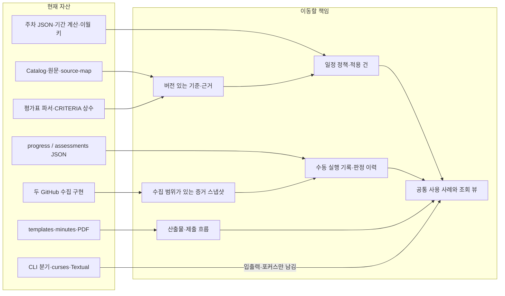

# 모델과 사용 흐름의 차이

[전체 지도](README.md) · [현재 구현](CURRENT.md) · [목표 설계](TARGET.md)

사용자가 느끼는 차이를 “기능이 적다”로 단정하지 않는다. 아래는 코드를 읽고 도출한 설계 관점의 진단이다. 실제 사용성 테스트 결과는 아니다.

| 관점 | 현재 main | 현재 prototype | 목표안 |
| --- | --- | --- | --- |
| 중심 단위 | 명령별 문서·결과 | 선택한 주차의 작업 트리 | 기준을 대상·기간에 적용한 안정적인 적용 건 |
| 첫 흐름 | 명령과 파일을 사용자가 조합 | 주차 → 할 일/평가/설정 | 지금 해야 할 일 → 기준/증거/판정 상세 |
| 기준 정의 | Markdown 표와 기능별 파서 | 원문·weeks.json·CRITERIA 상수 | 버전과 출처가 있는 기준 정의 |
| 기간 | week는 다음 수업, 회의록은 화~월+제출회차 | 화~월 학사 주차와 활동 제외 날짜 | 수업·활동·기록·마감의 서로 다른 의미를 명시 |
| 활동 수집 | 여러 팀원의 JSON 근거 초안 | 현재 개인의 주간 횟수·링크 | 범위·시각·완전성을 가진 증거 batch |
| 완료 | 자동 판정 안 함; 파일 존재만 검사 | 작업 수동 체크와 주간 횟수 상태 | 실행·산출물·제출·규칙 판정의 분리 |
| 설명 | 원문 링크·수동 확인 안내 | 기준·수집 시각·링크·수동 출처 | 판정 ID → 정책 버전·증거 스냅샷·이유 |
| 미완료 이월 | 통합 backlog 없음 | carry_next_week 항목을 바로 다음 주에 공유 | 기간이 바뀌어도 열린 적용 건과 원래 기한 유지 |
| UI와 조립 | cli.main의 분기·조립 | tui.App의 UI·수집·저장 조정 | CLI/TUI가 동일한 사용 사례 인터페이스 호출 |

## 현재 자산에서 유지할 것

- 원문 48쪽 전사·source-map·PDF 해시·원문과 팀 결정의 구분.
- 기록 기간·제출 회차·수업 회차를 구분한 회의록 생성, 기존 파일 보호, PDF 생성 후 제출로 자동 처리하지 않는 동작.
- 개인/저장소/기간별 상태 구분, 빈 값과 확인된 0의 구분, 항목별 수집 실패 시 기존 값 유지.
- 원문 조회를 GitHub 로그인과 분리한 흐름. 팀 설정 후보를 확인한 뒤 적용하는 방식.

## 먼저 고정할 도메인 불변식

1. 기준 정의를 바꾼다고 과거 적용 건의 정책·판정 이력을 덮어쓰지 않는다.
2. 개인 기준을 팀 합계로 충족 처리하지 않는다. 적용 대상은 개인 또는 팀으로 명시한다.
3. 미수집·수집 실패·부분 수집은 확인된 0과 다르다.
4. 작업 체크·초안 생성·PDF 생성·제출 확인·규칙 충족을 각각 기록한다.
5. 마감 경과와 완료는 다른 축이다. 지각 완료도 표현한다.
6. 기간 변경 시 미완료 적용 건과 원래 마감을 유지한다. 수업 예정일이 지났다고 수행을 추정하지 않는다.
7. 승인된 3인·3기능은 승인된 범위에만 적용한다. 배점·개인 활동 최소치까지 자동 환산하지 않는다.
8. 알려지지 않은 주간 집계 경계는 정책 결정으로 표시한다. prototype의 화~월은 구현된 해석이며 안내서의 유일한 확정 해석으로 취급하지 않는다.
9. 주간 진행량과 학기 점수 계산을 분리한다. PR·커밋 횟수만으로 실질성·리뷰 적정성·최종 점수를 확정하지 않는다.

## 집계 구현을 합치기 전 결정할 차이

| 항목 | main/activity.py | prototype/github_activity.py | 필요한 결정 |
| --- | --- | --- | --- |
| 대상 | 지정 팀원 여러 명 | config.me 한 명 | 개인·팀 조회의 공통 scope |
| 커밋 시각 | commit.author.date 추가 필터 | commit.committer.date 추가 필터 | 기준 시각 정의와 API 필터 의미 |
| 병합 커밋 | parents가 2개 이상이면 제외 | 별도 제외 조건 없음 | 의미 있는 커밋의 계수 정책 |
| PR | 생성·병합을 별도 시각으로 집계 | 같은 활성 구간 안에 생성되고 병합된 PR 검색 | 주간 생성·병합 기준의 해석 |
| 저장 결과 | categories의 error·links | counts·evidence·errors와 로컬 집계 기록 | 관측·집계·판정 스키마 분리 |
| 검색 완전성 | 목록 페이지를 읽음 | search의 incomplete_results·total_count도 확인 | 범위별 coverage 계약 |

각 차이는 구현에서 확인한 사실이다. 어느 쪽이 정답인지는 규칙 해석과 API 의미를 확인해 정한다. 이 문서는 GitHub 실데이터를 재집계하지 않았다.

## 목표 판정 결정표

위에서 아래 순서로 적용한다. 판정은 평가 시점에 대한 설명이며 외부 성적 확정이 아니다.

| 조건 | 결과 | 설명에 반드시 포함할 것 |
| --- | --- | --- |
| 규칙·승인·활동 구간 정책이 미확정 | 기준 확인 필요 | 질문, 충돌하는 근거, 영향 범위 |
| 확정 정책상 해당 대상·기간에 적용되지 않음 | 해당 없음 | 면제·적용 전·적용 밖 등의 사유 |
| 증거 범위·최신성 또는 필수 수동 확인이 부족 | 확인 필요 | 누락한 범위, 마지막 성공 시각, 수집 오류 |
| 충분한 증거가 완료 조건을 만족 | 충족 | 충족한 조건과 증거 링크 |
| 충분한 증거상 아직 미달이며 수행 구간이 남음 | 진행 중 | 남은 행동과 기한 |
| 충분한 증거상 미달이며 수행·판정 구간이 종료됨 | 미충족 | 미달 조건과 해당 기간 |

부분 충족·점수 환산은 별도 정책으로 둔다. 원문이 항목별 계산 방법을 충분히 정의하고 팀 변경의 승인 범위가 확인된 경우에만 적용한다. 확인 필요를 0점으로 바꾸지 않는다.

## 첫 구현에서 필요한 인터페이스

```text
collect(project, period) → CollectionReport
check(project, period, evidence_snapshot, evaluated_at) → Assessment[]
explain(assessment_id) → AssessmentExplanation
now(project, subject, as_of) → ActionView[]
```

CLI는 인자·종료코드·텍스트/JSON, TUI는 포커스·선택·갱신을 맡는다. 계수·기간 해석·수집 오류를 처리하는 코드를 화면별로 다시 작성하지 않는다. 순수 판정 모듈은 터미널이나 네트워크에 접근하지 않는다.

## 이동 순서

| 순서 | 결과물 | 완료 확인 |
| --- | --- | --- |
| 1 | 기준·기간 정책과 안정 ID | PR·커밋·이슈 3개 기준의 출처·scope·주기·면제·미확정 해석을 설명 가능 |
| 2 | 적용 건 생성 | 같은 사람·기준·기간에 안정적인 ID, 다음 주에도 기존 미완료 유지 |
| 3 | 증거 batch | 0·미수집·부분 실패·재시도·수동 정정을 원래 관측과 구분 |
| 4 | 판정·explain | 판정 버전과 증거를 고정하고 결과 이유를 동일하게 재현 |
| 5 | 공통 CLI 흐름 | 조회·수집·점검·설명과 JSON 출력이 같은 사용 사례 사용 |
| 6 | TUI 뷰 교체 | 지금 할 일·주차·개인·제출물에서 같은 적용 건 상세로 이동 |
| 7 | 산출물·제출 연결 | 초안·검토·PDF·실제 제출 확인의 상태를 구분 |

저장 방식은 JSON으로 시작해도 된다. 관계·이력·원자적 갱신 요구가 커질 때 SQLite 등의 저장 구현을 결정한다. 문서화 단계에서 서버나 특정 TUI 프레임워크를 추가 확정하지 않는다.

## 아직 결정하지 않은 것

- 제품의 최우선 대상: 개인의 과제 진행 지원인지, 팀 전체 운영인지. 초기 화면의 기본 scope에 영향.
- 활동 구간 경계·PR 생성/병합·커밋 시각과 의미 있는 변경의 판정 정책.
- LMS·이메일 제출 확인을 수동 증거로 받을지, 추후 연동할지.
- 수동 횟수 정정과 이후 GitHub 관측이 충돌할 때 채택·검토 정책.
- 증거 최신성 기준, 보존 기간, 판정 재실행·무효화 정책.
- CLI 명령의 호환 유지 범위, curses/Textual 선택, JSON 또는 DB 저장 방식.


## 현재 구현에서 목표 모델로 옮기는 지도

무엇을 살리고 무엇의 책임을 이동시켜야 하는가?



화면 라이브러리 교체보다 기준·기간·적용 건·증거·판정을 먼저 공통 인터페이스로 모은다. 원문·문서 생성·기존 기록은 단계적으로 연결한다.

범위·주의: 리팩터링 실행 계획의 초안이다. 오래된 횟수·수동 체크를 새 모델의 검증된 증거로 승격시키지 않는다. GitHub 두 구현은 집계 의미가 달라 그대로 합치지 않는다.

[SVG 크게 보기](rendered/18-migration-map.svg) · [Mermaid 원본](diagrams/18-migration-map.mmd)

구현 근거:

- [main: foss8/guide.py:115 · Catalog](https://github.com/sangjaepark0000/foss-8/blob/8e6ea27b07c7f287aa12d3b927ba3e9acae23732/foss8/guide.py#L115)
- [main: foss8/activity.py:30 · collect](https://github.com/sangjaepark0000/foss-8/blob/8e6ea27b07c7f287aa12d3b927ba3e9acae23732/foss8/activity.py#L30)
- [prototype: foss8/assessments.py:126 · Store](https://github.com/sangjaepark0000/foss-8/blob/8fc2ae6e6bf3e340067887fbeeb023ec7af65931/foss8/assessments.py#L126)
- [prototype: foss8/tui.py:100 · App](https://github.com/sangjaepark0000/foss-8/blob/8fc2ae6e6bf3e340067887fbeeb023ec7af65931/foss8/tui.py#L100)
