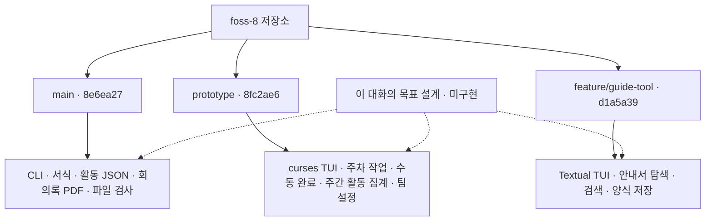
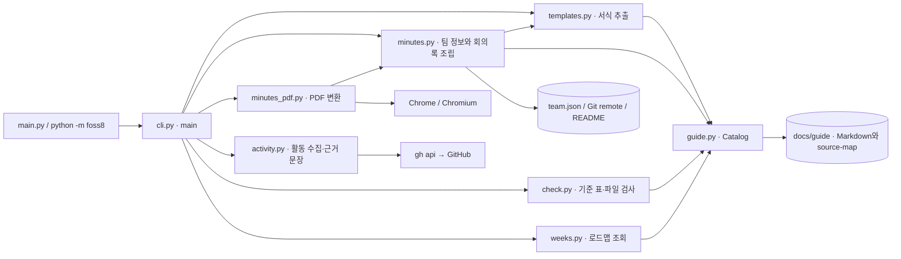
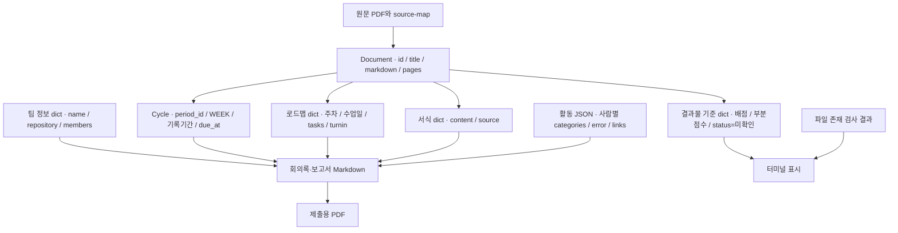
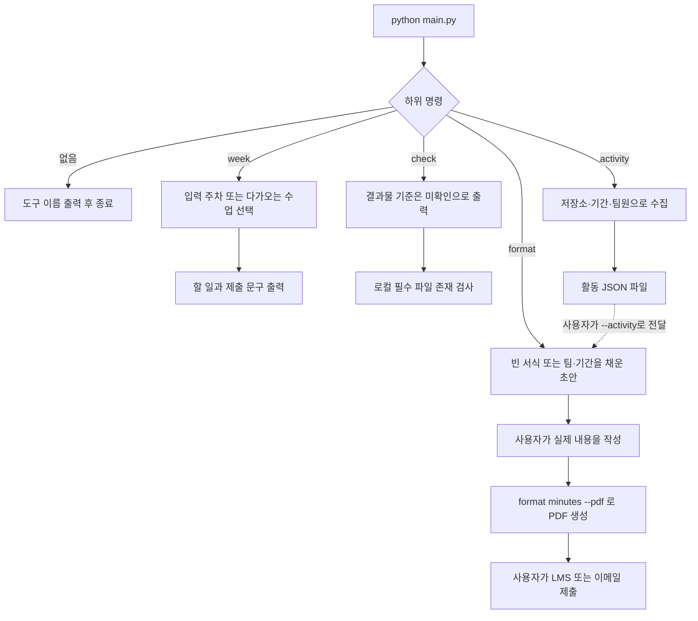
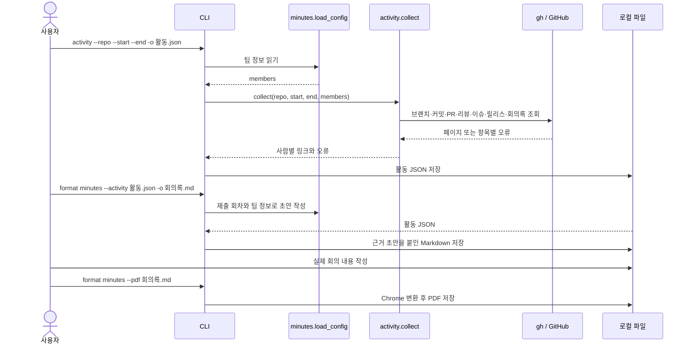
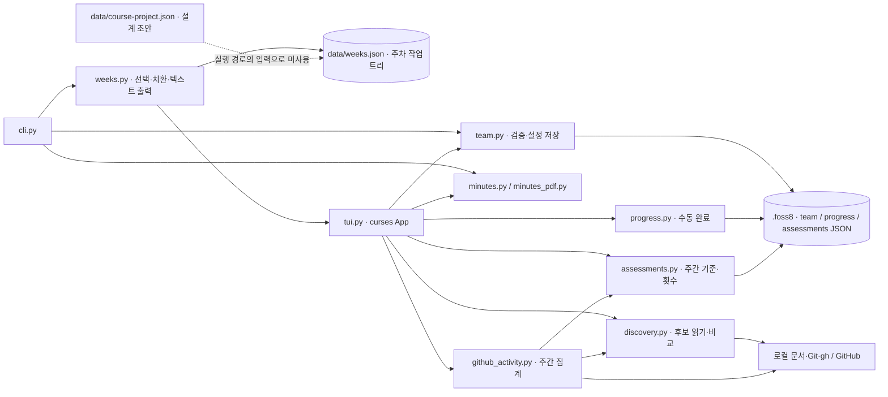
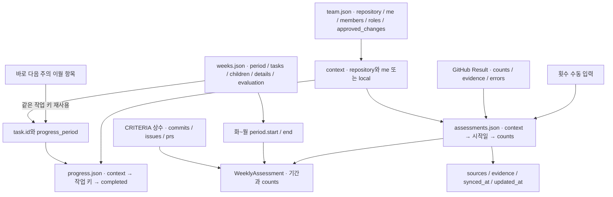
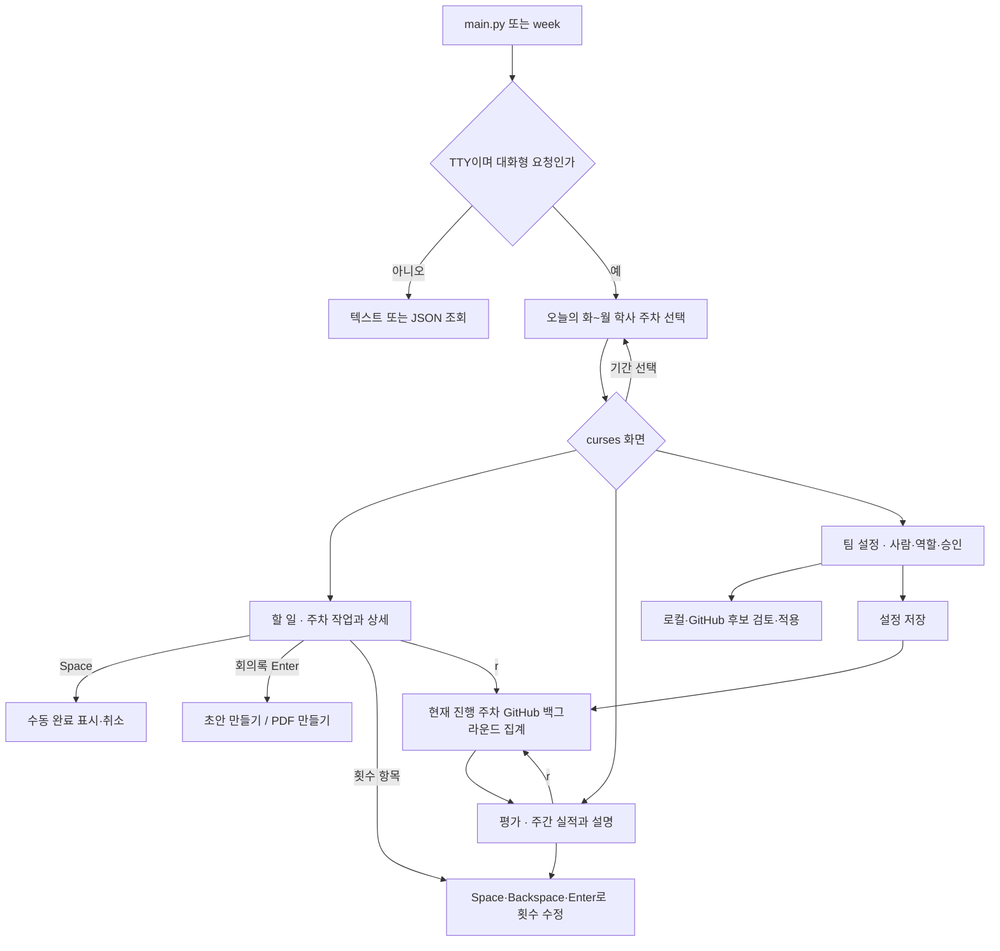
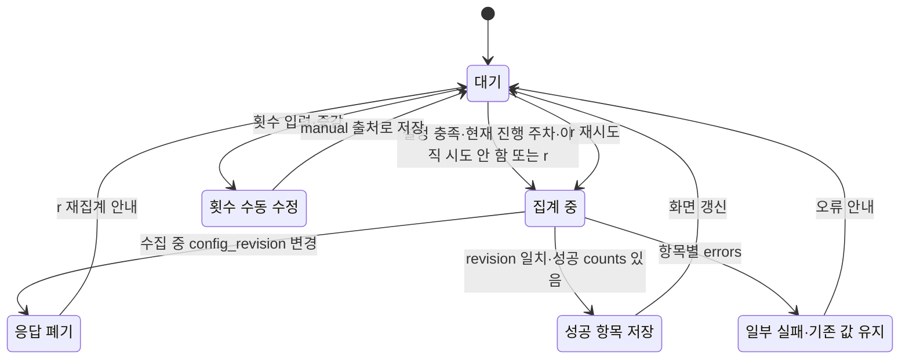

# foss-8 현재 구현 다이어그램

[전체 지도](README.md) · [목표 설계](TARGET.md) · [차이와 이동 순서](COMPARISON.md)

기준: 2026-11-15 원격 조회. 브랜치별 커밋은 [manifest.json](manifest.json)에 고정했다. 노드·호출·저장 경로는 코드에서 확인했으며 실제 사용자의 개인 상태 파일은 조사하지 않았다.

## 현재 저장소의 세 구현 범위

어느 브랜치의 기능을 현재 구현이라고 부르는가?

main, prototype, guide-tool은 서로 다른 실행 제품이다. 이 문서는 셋을 합쳐 이미 구현된 하나의 앱처럼 표시하지 않는다.

범위·주의: 세 선은 기능 범위의 분기이며 Git ancestry·병합 관계를 뜻하지 않는다. 원격 조회일은 2026-11-15이다.

[SVG 크게 보기](rendered/00-repository-scopes.svg) · [Mermaid 원본](diagrams/00-repository-scopes.mmd)

구현 근거:

- [main: foss8/cli.py:23 · parser](https://github.com/sangjaepark0000/foss-8/blob/8e6ea27b07c7f287aa12d3b927ba3e9acae23732/foss8/cli.py#L23)
- [prototype: foss8/cli.py:23 · parser](https://github.com/sangjaepark0000/foss-8/blob/8fc2ae6e6bf3e340067887fbeeb023ec7af65931/foss8/cli.py#L23)
- [guide-tool: foss8/cli.py:30 · parser](https://github.com/sangjaepark0000/foss-8/blob/d1a5a39c963e6ef1f38f2341e3c42259e1ae12a6/foss8/cli.py#L30)

## main의 실제 모듈과 의존성

현재 CLI 기능은 어떤 모듈을 호출하는가?

CLI main()에 명령 분기와 조립이 모인다. 공통 원문은 Catalog가 읽고, 일정·평가·서식이 각자 표를 해석한다.

범위·주의: main에는 TUI 실행 분기가 없다. Catalog의 검색 메서드가 존재하는 것과 CLI에 guide search 명령이 노출되는 것은 별개다.

[SVG 크게 보기](rendered/01-main-modules.svg) · [Mermaid 원본](diagrams/01-main-modules.mmd)

구현 근거:

- [main: foss8/cli.py:68 · main](https://github.com/sangjaepark0000/foss-8/blob/8e6ea27b07c7f287aa12d3b927ba3e9acae23732/foss8/cli.py#L68)
- [main: foss8/guide.py:115 · Catalog](https://github.com/sangjaepark0000/foss-8/blob/8e6ea27b07c7f287aa12d3b927ba3e9acae23732/foss8/guide.py#L115)
- [main: foss8/minutes.py:124 · load_config](https://github.com/sangjaepark0000/foss-8/blob/8e6ea27b07c7f287aa12d3b927ba3e9acae23732/foss8/minutes.py#L124)
- [main: foss8/minutes_pdf.py:141 · export](https://github.com/sangjaepark0000/foss-8/blob/8e6ea27b07c7f287aa12d3b927ba3e9acae23732/foss8/minutes_pdf.py#L141)

## main의 실제 정보 모델

문서에서 추출한 정보가 어떤 형태로 기능별로 흘러가는가?

Document와 Cycle은 명시적 타입이지만 활동·평가·주차는 대부분 기능별 dict이다. 공통 RequirementInstance나 판정 이력 모델은 없다.

범위·주의: 개념적 데이터 흐름도다. 저장된 관계형 DB나 이 이름의 테이블이 있다는 뜻이 아니다.

[SVG 크게 보기](rendered/02-main-information-model.svg) · [Mermaid 원본](diagrams/02-main-information-model.mmd)

구현 근거:

- [main: foss8/guide.py:108 · Document](https://github.com/sangjaepark0000/foss-8/blob/8e6ea27b07c7f287aa12d3b927ba3e9acae23732/foss8/guide.py#L108)
- [main: foss8/minutes.py:21 · Cycle](https://github.com/sangjaepark0000/foss-8/blob/8e6ea27b07c7f287aa12d3b927ba3e9acae23732/foss8/minutes.py#L21)
- [main: foss8/weeks.py:10 · roadmap](https://github.com/sangjaepark0000/foss-8/blob/8e6ea27b07c7f287aa12d3b927ba3e9acae23732/foss8/weeks.py#L10)
- [main: foss8/check.py:38 · load_result_items](https://github.com/sangjaepark0000/foss-8/blob/8e6ea27b07c7f287aa12d3b927ba3e9acae23732/foss8/check.py#L38)
- [main: foss8/activity.py:30 · collect](https://github.com/sangjaepark0000/foss-8/blob/8e6ea27b07c7f287aa12d3b927ba3e9acae23732/foss8/activity.py#L30)

## main의 현재 사용자 흐름

사용자는 현재 무엇을 입력하고 어떤 결과를 받는가?

문서 조회·활동 파일 생성·문서 작성·PDF 변환이 명령별로 나뉘며, 활동 JSON 전달과 실제 제출 확인은 사용자가 이어 붙인다.

범위·주의: 파일 생성 성공은 LMS 제출 성공이나 규칙 충족으로 저장되지 않는다. main의 week는 현재 학사 주차보다 가까운 이후 수업일을 고른다.

[SVG 크게 보기](rendered/03-main-cli-flow.svg) · [Mermaid 원본](diagrams/03-main-cli-flow.mmd)

구현 근거:

- [main: foss8/cli.py:23 · parser](https://github.com/sangjaepark0000/foss-8/blob/8e6ea27b07c7f287aa12d3b927ba3e9acae23732/foss8/cli.py#L23)
- [main: foss8/cli.py:68 · main](https://github.com/sangjaepark0000/foss-8/blob/8e6ea27b07c7f287aa12d3b927ba3e9acae23732/foss8/cli.py#L68)
- [main: foss8/weeks.py:38 · get_this_week](https://github.com/sangjaepark0000/foss-8/blob/8e6ea27b07c7f287aa12d3b927ba3e9acae23732/foss8/weeks.py#L38)

## main의 활동 수집·문서 생성 시퀀스

한 번의 활동 수집과 회의록 생성에서 무엇이 자동이고 무엇이 수동인가?

수집 실패는 항목의 error로 보존한다. 결과는 활동 근거 초안이며 평가 엔진으로 전달되지는 않는다.

[SVG 크게 보기](rendered/04-main-evidence-document-sequence.svg) · [Mermaid 원본](diagrams/04-main-evidence-document-sequence.mmd)

구현 근거:

- [main: foss8/activity.py:30 · collect](https://github.com/sangjaepark0000/foss-8/blob/8e6ea27b07c7f287aa12d3b927ba3e9acae23732/foss8/activity.py#L30)
- [main: foss8/cli.py:68 · main](https://github.com/sangjaepark0000/foss-8/blob/8e6ea27b07c7f287aa12d3b927ba3e9acae23732/foss8/cli.py#L68)
- [main: foss8/minutes.py:202 · draft](https://github.com/sangjaepark0000/foss-8/blob/8e6ea27b07c7f287aa12d3b927ba3e9acae23732/foss8/minutes.py#L202)
- [main: foss8/minutes_pdf.py:141 · export](https://github.com/sangjaepark0000/foss-8/blob/8e6ea27b07c7f287aa12d3b927ba3e9acae23732/foss8/minutes_pdf.py#L141)

## prototype의 실제 모듈 구조

키보드 TUI의 화면·저장·수집은 어디에서 조립되는가?

tui.App이 화면 상태와 팀 설정, 활동 수집 스레드, 저장 갱신을 함께 조정한다. weeks.py에는 데이터 선택과 텍스트 렌더링·TUI 진입이 함께 있다.

범위·주의: course-project.json은 문서화된 설계 초안이다. 점선은 실행 연결이 없다는 표시다. 현재 check 명령은 준비중을 출력한다.

[SVG 크게 보기](rendered/05-prototype-modules.svg) · [Mermaid 원본](diagrams/05-prototype-modules.mmd)

구현 근거:

- [prototype: foss8/weeks.py:268 · run](https://github.com/sangjaepark0000/foss-8/blob/8fc2ae6e6bf3e340067887fbeeb023ec7af65931/foss8/weeks.py#L268)
- [prototype: foss8/tui.py:100 · App](https://github.com/sangjaepark0000/foss-8/blob/8fc2ae6e6bf3e340067887fbeeb023ec7af65931/foss8/tui.py#L100)
- [prototype: foss8/tui.py:297 · start_activity](https://github.com/sangjaepark0000/foss-8/blob/8fc2ae6e6bf3e340067887fbeeb023ec7af65931/foss8/tui.py#L297)
- [prototype: foss8/team.py:126 · save](https://github.com/sangjaepark0000/foss-8/blob/8fc2ae6e6bf3e340067887fbeeb023ec7af65931/foss8/team.py#L126)
- [prototype: foss8/github_activity.py:32 · collect](https://github.com/sangjaepark0000/foss-8/blob/8fc2ae6e6bf3e340067887fbeeb023ec7af65931/foss8/github_activity.py#L32)

## prototype의 현재 데이터·식별 모델

완료 표시와 활동 횟수는 무엇을 키로 저장되는가?

주차별 화면 데이터와 수동 완료, 주간 횟수는 분리되어 있다. 다만 기준·작업의 정의는 트리 JSON·코드 상수·원문에 나뉘고 판정 스냅샷은 없다.

범위·주의: Task 체크는 사용자의 수동 표시다. WeeklyAssessment.status는 주간 횟수 상태이며 학기 점수나 LMS 제출 판정이 아니다. 서로 다른 집계 구간을 자동 재배분하지 않는다.

[SVG 크게 보기](rendered/06-prototype-information-model.svg) · [Mermaid 원본](diagrams/06-prototype-information-model.mmd)

구현 근거:

- [prototype: foss8/weeks.py:11 · load](https://github.com/sangjaepark0000/foss-8/blob/8fc2ae6e6bf3e340067887fbeeb023ec7af65931/foss8/weeks.py#L11)
- [prototype: foss8/progress.py:8 · context](https://github.com/sangjaepark0000/foss-8/blob/8fc2ae6e6bf3e340067887fbeeb023ec7af65931/foss8/progress.py#L8)
- [prototype: foss8/progress.py:45 · Progress](https://github.com/sangjaepark0000/foss-8/blob/8fc2ae6e6bf3e340067887fbeeb023ec7af65931/foss8/progress.py#L45)
- [prototype: foss8/assessments.py:58 · WeeklyAssessment](https://github.com/sangjaepark0000/foss-8/blob/8fc2ae6e6bf3e340067887fbeeb023ec7af65931/foss8/assessments.py#L58)
- [prototype: foss8/assessments.py:126 · Store](https://github.com/sangjaepark0000/foss-8/blob/8fc2ae6e6bf3e340067887fbeeb023ec7af65931/foss8/assessments.py#L126)

## prototype의 현재 사용자 흐름

주차 선택부터 완료 표시·활동 집계·회의록 작성까지 어떻게 이동하는가?

진입점과 작업 목록의 중심이 선택한 주차다. 사용자는 할 일·평가·팀 설정 탭을 오가며 서로 다른 종류의 상태를 편집한다.

범위·주의: 할 일의 개인 담당 필터는 아직 연결되지 않았다. 바로 다음 주 이월과 모든 과거 미완료를 계속 보여주는 backlog는 다르다.

[SVG 크게 보기](rendered/07-prototype-user-flow.svg) · [Mermaid 원본](diagrams/07-prototype-user-flow.mmd)

구현 근거:

- [prototype: foss8/weeks.py:268 · run](https://github.com/sangjaepark0000/foss-8/blob/8fc2ae6e6bf3e340067887fbeeb023ec7af65931/foss8/weeks.py#L268)
- [prototype: foss8/tui.py:164 · items](https://github.com/sangjaepark0000/foss-8/blob/8fc2ae6e6bf3e340067887fbeeb023ec7af65931/foss8/tui.py#L164)
- [prototype: foss8/tui.py:591 · handle](https://github.com/sangjaepark0000/foss-8/blob/8fc2ae6e6bf3e340067887fbeeb023ec7af65931/foss8/tui.py#L591)
- [prototype: foss8/tui.py:364 · minutes_action](https://github.com/sangjaepark0000/foss-8/blob/8fc2ae6e6bf3e340067887fbeeb023ec7af65931/foss8/tui.py#L364)

## prototype의 현재 집계 상태 전이

수동 수정과 GitHub 갱신·실패가 만날 때 어떻게 처리되는가?

설정 revision이 바뀐 응답은 버린다. 성공한 항목만 갱신하며 실패 항목의 기존 값은 유지한다. 수동 횟수는 다음 성공 집계에서 바뀔 수 있다.

범위·주의: 구현에서 보이는 동작을 추출한 상태도이며 실제 Enum 선언은 아니다. 성공과 항목별 오류는 한 응답에 공존할 수 있다.

[SVG 크게 보기](rendered/08-prototype-sync-state.svg) · [Mermaid 원본](diagrams/08-prototype-sync-state.mmd)

구현 근거:

- [prototype: foss8/tui.py:297 · start_activity](https://github.com/sangjaepark0000/foss-8/blob/8fc2ae6e6bf3e340067887fbeeb023ec7af65931/foss8/tui.py#L297)
- [prototype: foss8/tui.py:319 · poll_activity](https://github.com/sangjaepark0000/foss-8/blob/8fc2ae6e6bf3e340067887fbeeb023ec7af65931/foss8/tui.py#L319)
- [prototype: foss8/assessments.py:150 · save](https://github.com/sangjaepark0000/foss-8/blob/8fc2ae6e6bf3e340067887fbeeb023ec7af65931/foss8/assessments.py#L150)
- [prototype: foss8/github_activity.py:32 · collect](https://github.com/sangjaepark0000/foss-8/blob/8fc2ae6e6bf3e340067887fbeeb023ec7af65931/foss8/github_activity.py#L32)
