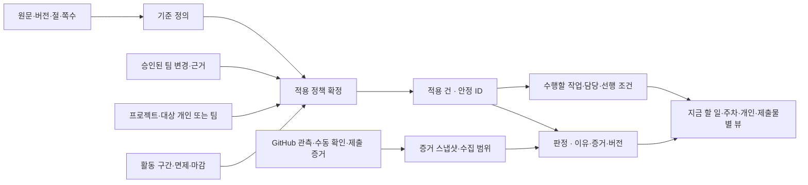
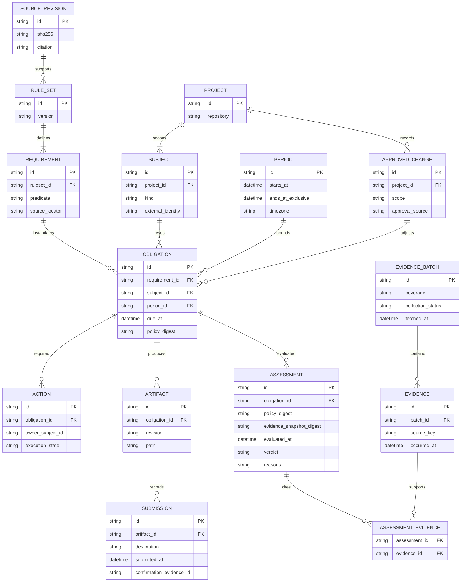
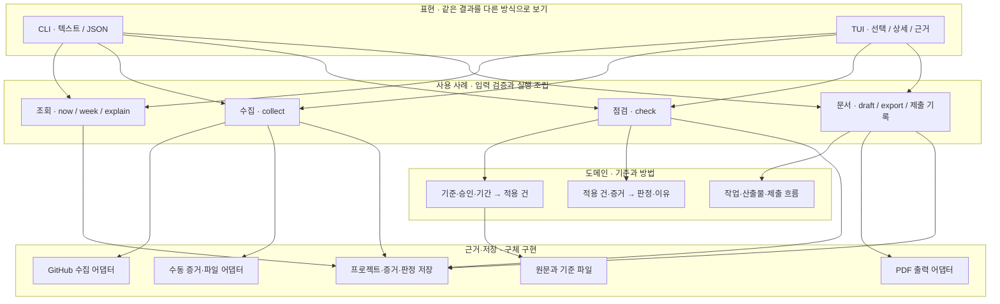
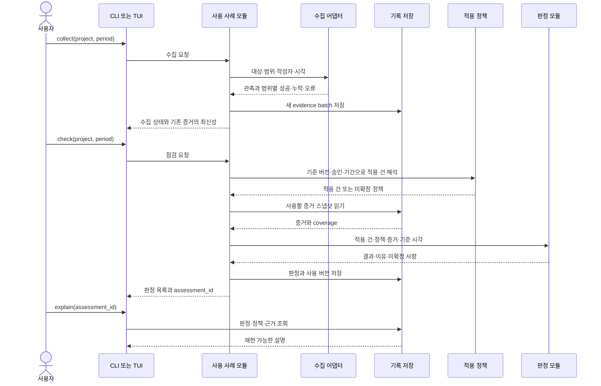
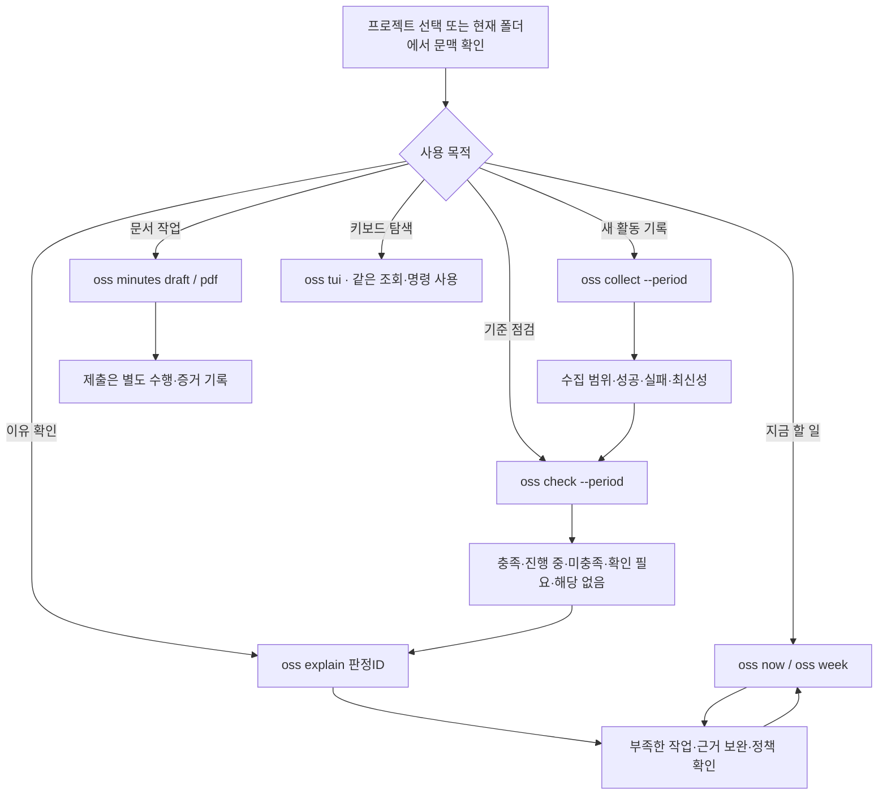
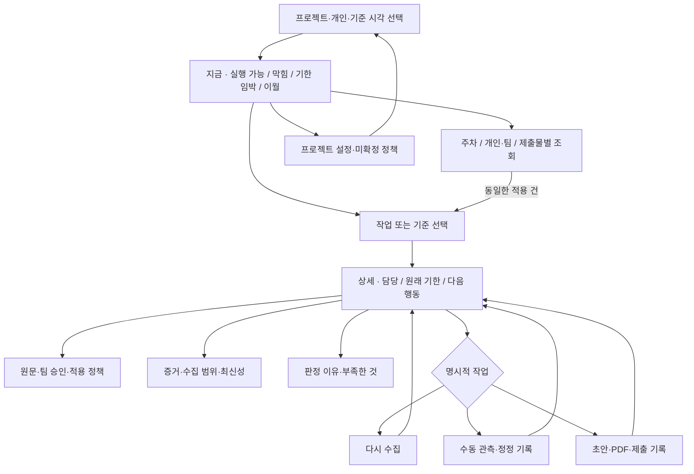
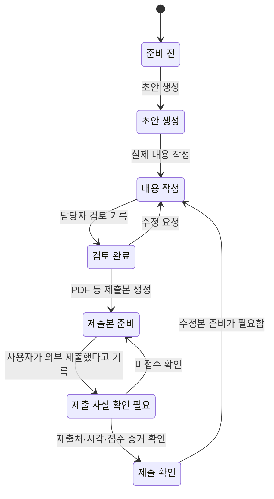
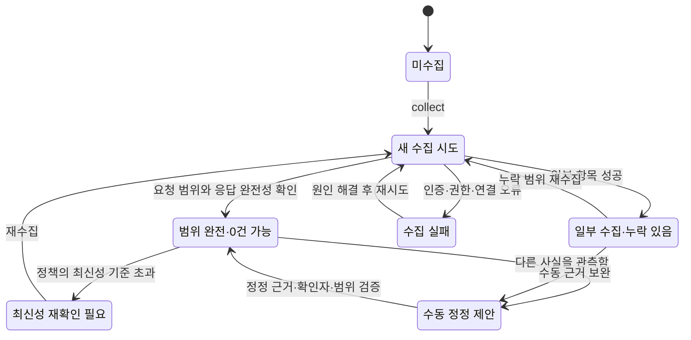
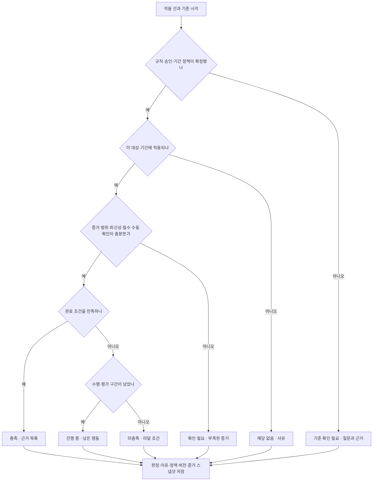

# 목표 설계 다이어그램

[전체 지도](README.md) · [현재 구현](CURRENT.md) · [차이와 이동 순서](COMPARISON.md)

상태: 이 대화에서 제안한 설계. 구현·DB·명령 이름·화면 프레임워크를 확정하지 않았다.

## 목표 도메인: 기준을 적용하고 근거로 설명하기

사용자가 원하는 점검을 표현하려면 어떤 개념을 분리해야 하는가?

핵심은 주차 트리에서 기준을 복사하는 대신, 기준 정의를 사람·팀·기간에 적용해 생성한 적용 건에 증거와 판정을 연결하는 것이다.

범위·주의: 이 대화에서 제안한 미구현 모델이다. 승인된 3인·3기능 변경이 곧 배점의 비례 환산을 뜻하지 않는다.

[SVG 크게 보기](rendered/09-target-domain.svg) · [Mermaid 원본](diagrams/09-target-domain.mmd)

설계 근거: 이 대화에서 합의한 기준 정의·적용 건·증거·판정 분리. 현재 미구현 제안.

## 목표 ERD: 적용 건·증거·판정의 식별

과거 판정을 재현하고 여러 뷰에서 같은 기준을 보려면 어떤 관계가 필요한가?

기준과 적용 건을 분리하고 판정은 사용한 정책·증거 버전을 고정한다. 기간 변경이나 재수집으로 과거 판정을 덮어쓰지 않는다.

범위·주의: 개념 ERD이며 DB 선택이나 최종 물리 스키마를 확정하지 않는다. predicate·coverage는 검증된 구조여야 하며 사용자 문자열을 eval하지 않는다. 관계 일부와 보조 조인 테이블은 가독성을 위해 생략했다.

[SVG 크게 보기](rendered/10-target-erd.svg) · [Mermaid 원본](diagrams/10-target-erd.mmd)

설계 근거: 이 대화에서 합의한 기준 정의·적용 건·증거·판정 분리. 현재 미구현 제안.

## 목표 모듈과 네 레이어

CLI와 TUI가 어떤 인터페이스를 공유해야 모델이 화면에 종속되지 않는가?

UI는 요청·출력과 포커스를 담당하고 collect/check/explain이 조립을 담당한다. 판정 모듈은 관측 저장이나 터미널 조작 없이 결과를 반환한다.

범위·주의: 미구현 설계안. 단일 로컬 프로그램 내부의 모듈 관계다. 별도 웹 서버·백그라운드 데몬·마이크로서비스 배포를 요구하지 않는다.

[SVG 크게 보기](rendered/11-target-modules.svg) · [Mermaid 원본](diagrams/11-target-modules.mmd)

설계 근거: 이 대화에서 합의한 기준 정의·적용 건·증거·판정 분리. 현재 미구현 제안.

## 목표 수집·점검·설명 시퀀스

수집이 실패해도 사용자가 왜 확인이 필요한지 추적할 수 있는가?

collect와 check는 분리한다. check는 고정된 증거 스냅샷으로 판정하고 explain은 같은 판정의 기준·이유·근거를 다시 읽는다.

범위·주의: 네트워크 자동 갱신을 check 내부에 숨기지 않는 초기 인터페이스안이다. collect 실패 시 이전 batch와 실패한 새 시도를 함께 보존한다.

[SVG 크게 보기](rendered/12-target-check-sequence.svg) · [Mermaid 원본](diagrams/12-target-check-sequence.mmd)

설계 근거: 이 대화에서 합의한 기준 정의·적용 건·증거·판정 분리. 현재 미구현 제안.

## 목표 CLI의 작업 흐름

명령을 외우는 사람과 자동화가 같은 도메인 작업을 수행할 수 있는가?

프로젝트 문맥을 고른 뒤 조회·수집·점검·설명·문서 작업을 독립 명령으로 수행한다. 읽기 작업은 상태를 암묵적으로 변경하지 않는다.

범위·주의: 명령 이름은 제안이다. main의 기존 check와 prototype의 week 동작을 이미 바꿨다는 뜻이 아니다. 모든 CLI 결과에는 텍스트와 JSON 표현을 함께 설계한다.

[SVG 크게 보기](rendered/13-target-cli-flow.svg) · [Mermaid 원본](diagrams/13-target-cli-flow.mmd)

설계 근거: 이 대화에서 합의한 기준 정의·적용 건·증거·판정 분리. 현재 미구현 제안.

## 목표 TUI: 사용자 목적에서 근거까지

주차를 바꿔도 남은 작업·원래 기한·판정 근거를 잃지 않는가?

첫 화면은 현재 실행 가능한 일·막힘·마감·이월을 보여준다. 주차는 여러 조회 축 중 하나이며 같은 적용 건을 계속 참조한다.

범위·주의: 텍스트 화면 이동 설계이며 완성된 TUI 스크린샷이 아니다. 사용자 체크, 수집 성공, 문서 생성, LMS 제출, 규칙 충족은 각각 별도의 표시다.

[SVG 크게 보기](rendered/14-target-tui-flow.svg) · [Mermaid 원본](diagrams/14-target-tui-flow.mmd)

설계 근거: 이 대화에서 합의한 기준 정의·적용 건·증거·판정 분리. 현재 미구현 제안.

## 목표 산출물·제출 상태

PDF를 만들었다는 사실과 제출 완료·기한 준수를 어떻게 구분하는가?

산출물 준비와 외부 제출 확인을 분리한다. 기한 준수는 제출 시각과 고정 마감의 비교값이며 상태를 되돌리는 조건이 아니다.

범위·주의: 재제출 시 기존 제출 이력은 보존하고 새 산출물 revision·제출 건을 만든다. 파일 생성·체크 표시만으로 Confirmed로 이동하지 않는다. 지각 여부는 별도 속성이다.

[SVG 크게 보기](rendered/15-target-submission-state.svg) · [Mermaid 원본](diagrams/15-target-submission-state.mmd)

설계 근거: 이 대화에서 합의한 기준 정의·적용 건·증거·판정 분리. 현재 미구현 제안.

## 목표 증거 수집·정정 상태

실패·누락·오래된 근거·수동 정정을 어떻게 보존할 것인가?

성공한 0건과 미수집을 구분하며 실패로 기존 증거를 덮어쓰지 않는다. 수동 정정도 원래 관측과 나란히 기록한다.

범위·주의: batch마다 새 기록을 만든다는 개념 상태도다. 재수집 중 이전 성공 batch는 계속 남는다. 증거 수집 상태와 규칙 판정값은 별도다. 최신성 기간은 아직 미확정이다.

[SVG 크게 보기](rendered/16-target-evidence-state.svg) · [Mermaid 원본](diagrams/16-target-evidence-state.mmd)

설계 근거: 이 대화에서 합의한 기준 정의·적용 건·증거·판정 분리. 현재 미구현 제안.

## 목표 판정 결정 흐름

어떤 조건에서 충족·미충족·확인 필요라고 설명할 수 있는가?

적용 정책과 증거의 충분성을 먼저 확인한다. 횟수만으로 의미 있는 변경·승인된 리뷰·최종 점수를 자동 확정하지 않는다.

범위·주의: 부분 충족·점수 환산은 이 흐름 다음의 별도 정책이며, 원문과 승인 근거가 충분한 항목에만 적용한다. 진행 중에도 충족 조건이 취소될 수 있는 규칙은 평가 시점 정책이 필요하다.

[SVG 크게 보기](rendered/17-target-decision-flow.svg) · [Mermaid 원본](diagrams/17-target-decision-flow.mmd)

설계 근거: 이 대화에서 합의한 기준 정의·적용 건·증거·판정 분리. 현재 미구현 제안.
